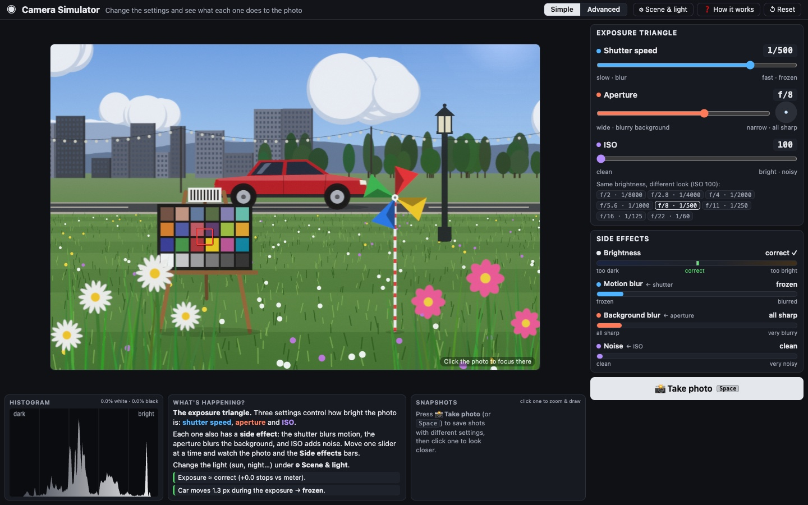
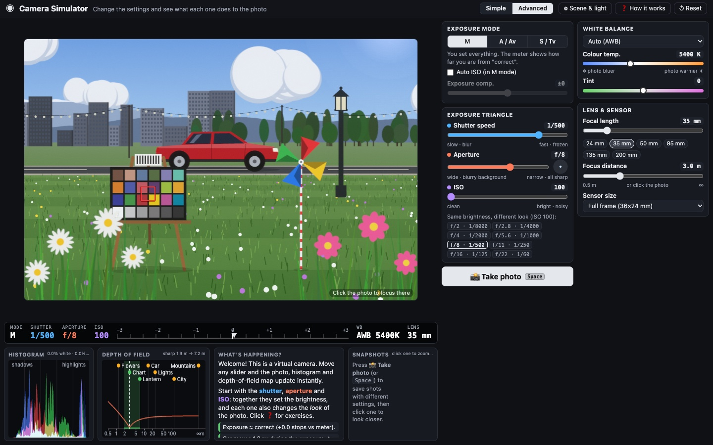
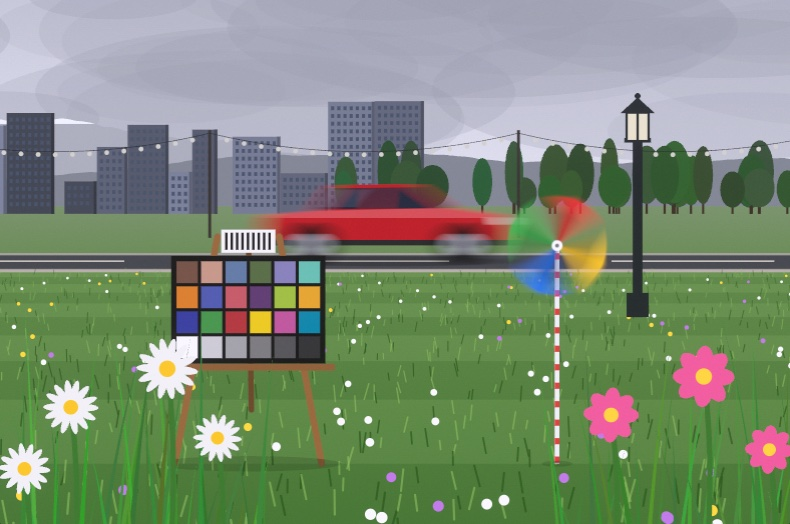
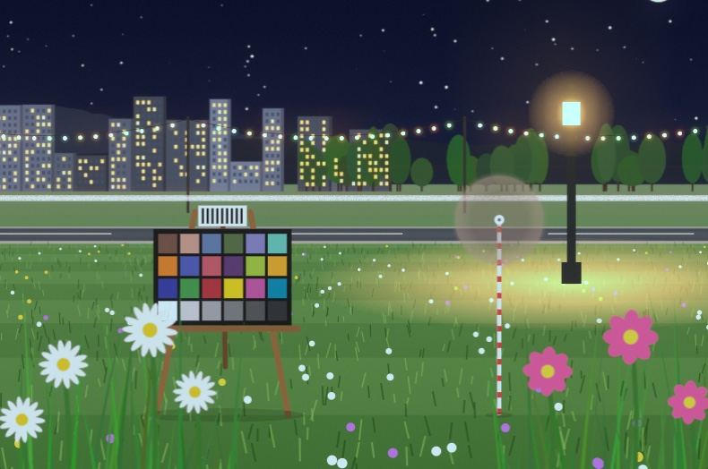
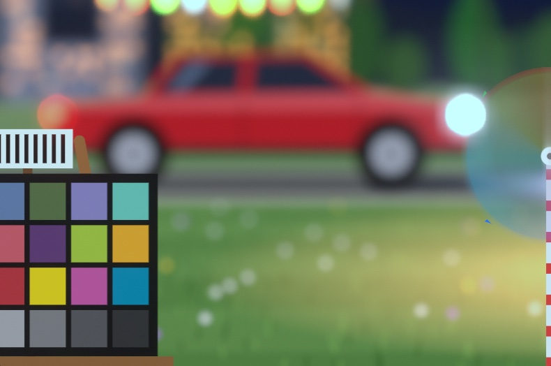
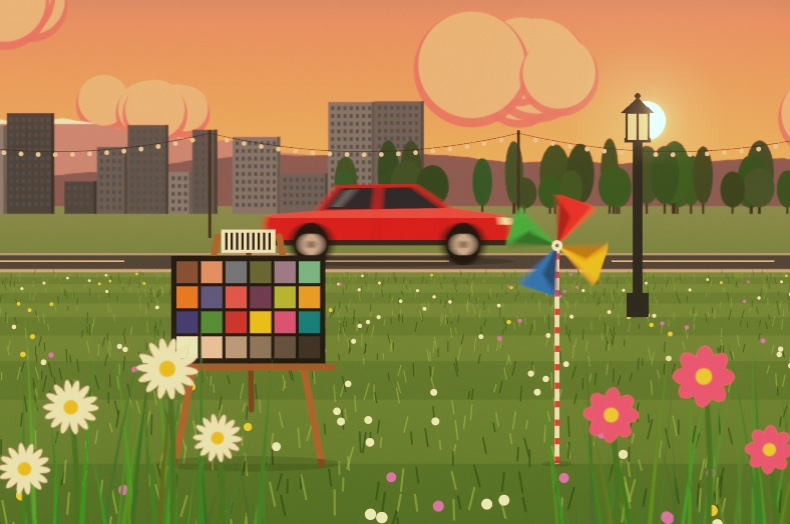
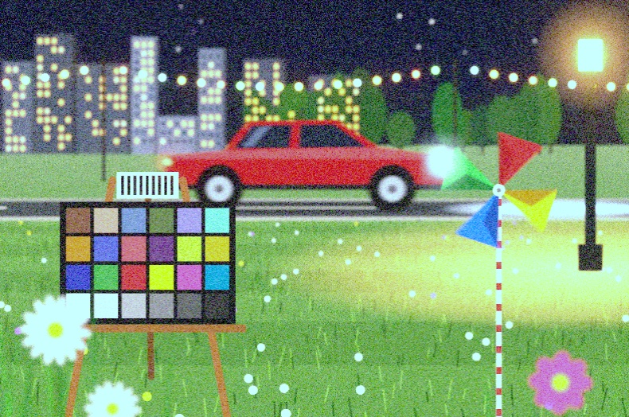

# 📷 Camera Simulator

**An interactive, physically based camera simulator for teaching photography.**
Change shutter speed, aperture, ISO, white balance, focal length, focus, sensor size and stabilisation,
and see the photo change immediately.

### ▶ [Open the live simulator](https://amin-hp.github.io/camera-simulator/)

Two levels, switchable at the top of the page:

| **Simple**: only the exposure triangle, plus a *Side effects* panel | **Advanced**: every camera setting |
|---|---|
|  |  |

| Motion blur: 1/15 s | Light trails: 8 s, tripod |
|---|---|
|  |  |
| **Bokeh: 85 mm f/1.4** | **White balance: Daylight WB at golden hour** |
|  |  |
| **High ISO: 25600 at night** | |
|  | |

---

## Contents

- [Quick start](#quick-start)
- [What each setting does](#what-each-setting-does)
- [The screen, explained](#the-screen-explained)
- [Exercises for the classroom](#exercises-for-the-classroom)
- [Light presets](#light-presets)
- [Share a setup with a link](#share-a-setup-with-a-link)
- [How it works (technical)](#how-it-works-technical)
- [Run locally](#run-locally)

## Quick start

1. Open the [live simulator](https://amin-hp.github.io/camera-simulator/) in Chrome, Edge, Firefox or Safari (it needs WebGL2, which all current browsers support).
2. Choose **Simple** or **Advanced** at the top (see below). Change the light, moving subjects and tripod/handheld under **⚙ Scene & light**.
3. Move any slider. The photo, the exposure meter, the histogram and the depth-of-field map update instantly.
4. **Click the photo** to focus on whatever is under the cursor.
5. Press **Space** (or 📸 *Take photo*) to save a snapshot. Take several with different settings and compare them.
   **Click a snapshot** to open it full-screen: zoom in (scroll/pinch, +/−) to inspect noise and blur, drag to move,
   and use the 🖌 **brush** to circle or point at details while you explain. ◀ ▶ flips between snapshots,
   *Use these settings* loads the shot's settings back into the camera, and drawings are erased when you close the viewer.
6. Click **❓ How it works** in the app for a built-in guide.

## Simple and Advanced

**Simple** is for a first lesson. It shows only **shutter speed, aperture and ISO**, a **brightness histogram**, and a **Side effects** panel with four live gauges:

| Gauge | Changed by | Shows |
|---|---|---|
| Brightness | all three | too dark ↔ correct ↔ too bright |
| Motion blur | shutter speed | frozen ↔ blurred (the car, the pinwheel, camera shake) |
| Background blur | aperture | all sharp ↔ very blurry |
| Noise | ISO | clean ↔ very noisy |

Simple mode also has **📸 Take photo** and the snapshot viewer. In Simple mode the camera stays in Manual with Auto white balance, so only the three triangle settings change the photo.

**Advanced** adds exposure modes (M / A / S, Auto ISO, exposure compensation), white balance, focal length, focus, sensor size, the RGB histogram, the depth-of-field map and snapshots.

**⚙ Scene & light** (a pop-up, available in both modes) holds the light preset, car speed, pinwheel, tripod/handheld/IS and the over-exposure blink. Your choice of Simple or Advanced is remembered by the browser.

## What each setting does

### The exposure triangle

Shutter speed, aperture and ISO together set how **bright** the photo is. Each one also changes how the photo **looks**.

| Setting | Brightness | Side effect |
|---|---|---|
| **Shutter speed**: how long the sensor collects light | Each doubling of time = **+1 stop** (2× the light) | **Motion blur.** The car (40 km/h) and the spinning pinwheel freeze at fast speeds and smear at slow ones. Handheld, slow speeds also blur the *whole* image (camera shake). At night, long exposures leave **light trails**. |
| **Aperture (f-number)**: size of the lens opening | A smaller f-number means a bigger hole. f/2.8 → f/4 = **−1 stop** (half the light) | **Depth of field.** Wide apertures (f/1.4–2.8) blur the background and turn lights into round **bokeh** discs. Narrow apertures (f/11–22) make everything sharp, and bokeh takes the shape of the 7 aperture blades. Beyond f/16, diffraction softens slightly. |
| **ISO**: amplification of the sensor signal | Each doubling = **+1 stop** | **Noise.** ISO doesn't add light; it amplifies the signal, *including* its noise. Highlights also clip sooner. |

Full-stop sequences to remember:

- Shutter: 1/1000 · 1/500 · 1/250 · 1/125 · 1/60 · 1/30 · 1/15 …
- Aperture: f/1.4 · 2 · 2.8 · 4 · 5.6 · 8 · 11 · 16 · 22
- ISO: 100 · 200 · 400 · 800 · 1600 · 3200 …

The **"Same brightness, different look"** buttons under the triangle list equivalent exposures, e.g. f/2.8 · 1/1000 = f/8 · 1/125 = f/22 · 1/15.
Click them to see that the brightness stays the same while the depth of field and motion blur change.

### Exposure modes

- **M (Manual)**: you set everything. The meter only shows how far you are from "correct". Tick **Auto ISO** to have the camera choose the ISO.
- **A / Av (Aperture priority)**: you choose the aperture; the camera chooses the shutter speed.
- **S / Tv (Shutter priority)**: you choose the shutter speed; the camera chooses the aperture.
- **Exposure compensation** (in A, S or Auto ISO) makes the auto result brighter (+) or darker (−). If the camera runs out of range, the meter needle blinks and a warning explains what to do (e.g. use an ND filter in bright sun).

### White balance

Light has a colour, measured in kelvin (K): tungsten ≈ 2700–3200 K (orange), sunlight ≈ 5500 K, shade or blue sky ≈ 7000–10000 K (blue).
The WB setting tells the camera which light to neutralise:

- WB set **lower** than the real light → the photo turns **blue**.
- WB set **higher** than the real light → the photo turns **orange**.
- WB matches the light → the **grey patches** at the bottom of the colour chart are neutral.

Choose a preset (Auto, Daylight, Cloudy, Shade, Tungsten, Fluorescent, Flash), drag the kelvin slider for a custom value, and use **Tint** for green/magenta.

### Lens, sensor and support

- **Focal length (24–200 mm)**: longer lenses magnify, give shallower depth of field, and magnify camera shake.
- **Focus distance**: use the slider or click the photo. The depth-of-field map shows the sharp zone.
- **Sensor size** (full frame, APS-C, Micro 4/3): the crop factor narrows the view and changes depth of field and shake.
- **Tripod / Handheld / Handheld + IS**: handheld shake follows the rule of thumb *shutter faster than 1/(focal length × crop)*. Image stabilisation gains about 3.5 stops, but it does **not** freeze moving subjects.

## The screen, explained

| Part | What it tells you |
|---|---|
| **Camera display** | Mode, shutter, aperture, ISO, WB and lens, like a real camera's viewfinder. |
| **Exposure meter (−3 … +3)** | 0 = the exposure the light meter suggests. +1 = twice as bright, −1 = half as bright. The needle turns red when you're off, and blinks beyond ±3. |
| **Histogram** | Brightness distribution from shadows (left) to highlights (right). A pile against the right wall = blown highlights; against the left wall = lost shadows. Shows the % of clipped pixels. |
| **Blink over-exposed areas** | Red stripes mark parts of the photo blown to pure white. |
| **Depth-of-field map** | Distance scale from 0.5 m to ∞ with every object in the scene. The green zone is acceptably sharp, the dashed line is the focus distance, and the orange curve shows blur growing with distance from the focus point. |
| **What's happening?** | An explanation of the setting you just changed, plus live warnings (exposure, clipping, camera shake, noise, motion, focus, white balance, diffraction). |
| **Snapshots** | Saved full-resolution photos with their settings (in both Simple and Advanced). Click one to open the viewer, where you can zoom, pan and draw. |

## Exercises for the classroom

1. **Freeze vs. blur:** "Overcast", S mode. Compare the car at 1/1000 and at 1/15. Then switch to handheld at 1/4: now *everything* blurs.
2. **Portrait background:** click the chart to focus, set 85 mm at f/1.8, then f/16. Watch the depth-of-field map.
3. **Bokeh:** "Night", tripod, focus on the chart, 85 mm at f/1.4, then f/8. Look at the shape of the light discs.
4. **Light trails:** "Night", tripod, ISO 100, f/8, and a 4–15 s exposure.
5. **Noise:** "Night", handheld, 1/125 s, f/2.8. Raise the ISO until it's bright enough. How noisy is it?
6. **Equivalent exposures:** click the "same brightness" buttons. What changes, and what stays the same?
7. **White balance:** in "Golden hour" try Daylight, Tungsten and Shade. In "Blue hour", can one WB make both the sky and the lamps neutral?
8. **Crop sensor:** keep 50 mm and switch to APS-C and Micro 4/3. The view narrows and the safe handheld shutter speed changes.
9. **Sunny 16:** in "Sunny day", set f/16 and ISO 100. Which shutter speed gives a correct exposure?
10. **Protect the highlights:** "Night", A mode. Use exposure compensation to stop the lamps from clipping while keeping the scene visible.

## Light presets

| Preset | Meter (EV at ISO 100) | Light colour | Good for |
|---|---|---|---|
| ☀️ Sunny day | 15 | 5500 K | Sunny 16, fast shutter, clipping |
| ☁️ Overcast | 12 | 6800 K | Motion blur, soft light |
| 🌅 Golden hour | 12 | 3400 K | White balance |
| 🌆 Blue hour | 7 | 9500 K sky + 2800 K lamps | Mixed light |
| 🌙 Night | 3 | 4200 K + 2700 K lamps | Long exposure, bokeh, ISO noise, tripod |

## Share a setup with a link

Add settings after `#` in the URL to open the simulator ready for a lesson:

- [Light trails](https://amin-hp.github.io/camera-simulator/#lighting=night&support=tripod&focal=35&aperture=8&shutter=8&iso=100): `#lighting=night&support=tripod&focal=35&aperture=8&shutter=8&iso=100`
- [Portrait bokeh](https://amin-hp.github.io/camera-simulator/#lighting=night&support=tripod&focal=85&aperture=1.4&shutter=1/4&iso=100&car=0): `#lighting=night&support=tripod&focal=85&aperture=1.4&shutter=1/4&iso=100&car=0`
- [Aperture priority](https://amin-hp.github.io/camera-simulator/#mode=A&aperture=1.8&focal=85): `#mode=A&aperture=1.8&focal=85`

| Parameter | Values |
|---|---|
| `lighting` | `sunny`, `overcast`, `golden`, `bluehour`, `night` |
| `mode` | `M`, `A`, `S` |
| `shutter` | seconds, e.g. `1/250`, `0.5`, `8` |
| `aperture` | f-number, e.g. `2.8` |
| `iso` | e.g. `400` |
| `ec` | exposure compensation in stops, e.g. `-1` |
| `wb` | `auto`, `daylight`, `cloudy`, `shade`, `tungsten`, `fluorescent`, `flash`, or a kelvin number like `4500` |
| `focal` | 24–200 (mm) |
| `focus` | metres, or `inf` |
| `sensor` | `ff`, `apsc`, `m43` |
| `support` | `tripod`, `handheld`, `is` |
| `car` | car speed in km/h (`0` = parked) |
| `autoiso`, `zebra` | `1` or `0` |
| `ui` | `simple` or `advanced` |
| `open` | `settings` opens the Scene & light pop-up |

## How it works (technical)

- **The scene** is drawn procedurally in layers at real distances: flowers 1.2 m, chart 3 m, lantern 7 m, car 14 m, fairy lights 25 m, city 120 m, mountains ∞. The ground has per-pixel distance.
- **Light** is handled in linear HDR. Lamps, the sun and headlights can be far brighter than white, so they clip, glow and leave trails as they would in a real camera.
- **Exposure:** `EV100 = log2(N² / t) − log2(ISO / 100)`. Brightness = 2^(scene EV − camera EV).
- **Depth of field:** a thin-lens circle of confusion `c = f² / (N (s − f)) · |d − s| / d`, rendered as a disc gather shaped by a 7-blade iris. DoF limits use the standard 0.03 mm CoC ÷ crop factor.
- **Motion blur:** the exact time-integral of the moving car and the rotating pinwheel over the exposure.
- **Camera shake** grows with focal length × shutter time (reduced by IS).
- **Sensor:** photon shot noise + read noise, amplified by ISO gain, then clipping, white-balance gains, lens glare and sRGB encoding.
- **No libraries or build step:** plain HTML, CSS, JavaScript and WebGL2.

```
index.html        page layout + built-in help
css/style.css     styles (one-screen layout)
js/camera.js      exposure maths, value tables, optics, colour temperature
js/scene.js       procedural scene, distances, light presets
js/renderer.js    WebGL2 pipeline: DoF, motion blur, shake, glare, noise, WB
js/app.js         UI, camera modes, explanations, histogram, DoF map, snapshots
```

## Run locally

Download or clone the repository and open `index.html` in a browser. No server or internet connection is needed.

```bash
git clone https://github.com/Amin-HP/camera-simulator.git
open camera-simulator/index.html
```
